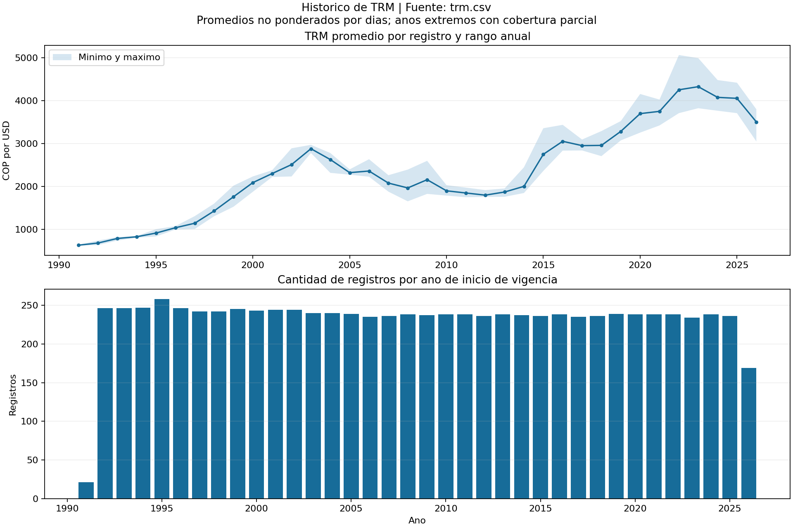
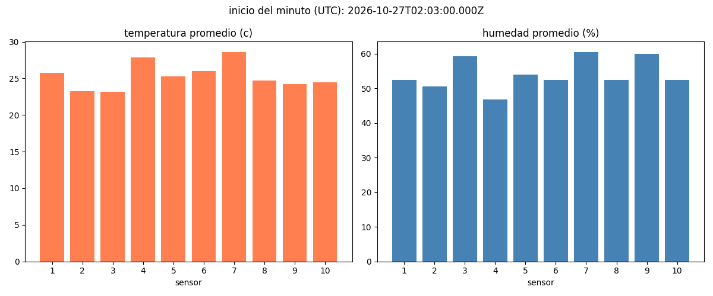

# Tarea 3 – Procesamiento de datos con Apache Spark y Kafka

**Estudiante:** Mery Johana Vergara  
**Universidad:** Universidad Nacional Abierta y a Distancia – UNAD  
**Curso:** Big Data

## Descripción

Este proyecto presenta dos ejercicios:

1. Procesamiento por lotes (batch) del histórico de la tasa de cambio representativa del mercado (TRM) con Apache Spark.
2. Procesamiento de lecturas simuladas de temperatura y humedad con Kafka y Spark Structured Streaming.

Las visualizaciones se generan con Matplotlib y se guardan como imágenes.

## Entorno utilizado

- Ubuntu en VirtualBox, con 2 GB de RAM.
- Python 3.10 y Java 11.
- Apache Spark 3.5.8, con Scala 2.12.
- Apache Kafka 3.9.2.
- Bibliotecas de Python: kafka-python y matplotlib.

Los comandos corresponden al usuario `hadoop`, con los programas en `/home/hadoop`.

## 1. Análisis batch de la TRM

### Fuente de los datos

Se utilizó el archivo `trm.csv`, obtenido del conjunto Tasa de cambio representativa del mercado histórico del portal Datos Abiertos Colombia.

Fuente: https://www.datos.gov.co/resource/mcec-87by

El archivo utilizado contiene 8.351 registros y estas columnas:

- `VALOR`: tasa de cambio en pesos colombianos por dólar estadounidense.
- `UNIDAD`: unidad monetaria.
- `VIGENCIADESDE`: fecha inicial de vigencia.
- `VIGENCIAHASTA`: fecha final de vigencia.

### Procedimiento

El programa `analisis_trm.py` realiza:

1. Lectura del CSV con Spark.
2. Revisión de valores nulos o vacíos.
3. Normalización de espacios y de la unidad monetaria.
4. Conversión del valor a número y de las fechas a tipo fecha.
5. Validación de valores positivos, unidad COP y orden de las fechas.
6. Eliminación de duplicados exactos.
7. Creación de las columnas de año y mes.
8. Cálculo de estadísticas descriptivas.
9. Agrupación anual para obtener conteos, promedios, mínimos y máximos.
10. Selección de registros con TRM superior a 5.000 COP por USD.
11. Exportación de resultados y generación de gráficas.

Los valores altos que cumplen las reglas de validación se conservan.

### Resultados de calidad

| Indicador | Resultado |
|---|---:|
| Registros originales | 8.351 |
| Valores nulos o vacíos en las columnas revisadas | 0 |
| Registros inválidos | 0 |
| Duplicados eliminados | 0 |
| Registros finales | 8.351 |

La validación no requirió eliminar registros ni completar valores faltantes.

### Resultados descriptivos

- Promedio por registro: aproximadamente 2.370,93 COP por USD.
- Mínimo: 620,62 COP por USD.
- Máximo: 5.061,21 COP por USD.
- Registros superiores a 5.000 COP por USD: 5.

Cada registro puede abarcar varios días de vigencia. Por ello, cinco registros no equivalen necesariamente a cinco días.

### Ejecución

Con `trm.csv` y `analisis_trm.py` en `/home/hadoop`, ejecutar:

```bash
/home/hadoop/spark-3.5.8-bin-hadoop3/bin/spark-submit --master 'local[1]' --driver-memory 512m /home/hadoop/analisis_trm.py
```

Este ejercicio utiliza el CSV local y no requiere que Kafka, ZooKeeper o HDFS estén activos.

Cada ejecución crea una carpeta nueva dentro de:

```text
/home/hadoop/resultados_trm/
```

Al finalizar aparece el mensaje `ANALISIS TERMINADO`, seguido de la ruta de los resultados.

### Archivos del análisis batch

| Archivo | Contenido |
|---|---|
| `analisis_trm.py` | Programa de procesamiento batch y visualización |
| `trm.csv` | Datos originales |
| `calidad.json` | Conteos de validación y limpieza |
| `datos_limpios.csv` | Datos validados y transformados |
| `estadisticas.csv` | Estadísticas descriptivas de la TRM |
| `resumen_anual.csv` | Conteos, promedios, mínimos y máximos por año |
| `valores_mayores_5000.csv` | Registros con TRM superior a 5.000 |
| `rechazados.csv` | Registros inválidos; en esta ejecución solo contiene encabezados |
| `grafica_trm.png` | Visualización del análisis |
| `notas.txt` | Alcance y límites de interpretación |

### Visualización



La gráfica superior muestra el promedio por registro y el rango entre el mínimo y el máximo de cada año. La inferior muestra la cantidad de registros por año de inicio de vigencia.

Los años 1991 y 2026 tienen cobertura parcial. Los promedios no están ponderados por el número de días de vigencia.

## 2. Procesamiento de sensores con Kafka y Spark

### Descripción

El productor simula lecturas de temperatura y humedad de diez sensores. Envía una lectura cada segundo, seleccionando aleatoriamente un sensor.

Kafka recibe los mensajes en el tema `sensor_data`. Spark Structured Streaming calcula los promedios por sensor en ventanas de un minuto y escribe los resultados en JSON.

Un programa adicional lee los resultados del último minuto disponible y genera la gráfica.

### Archivos de sensores

| Archivo | Función |
|---|---|
| `sensor_producer.py` | Genera y envía las lecturas a Kafka |
| `spark_streaming.py` | Procesa los mensajes y calcula promedios |
| `grafica_sensores.py` | Lee los resultados y genera la imagen |
| `grafica_sensores.png` | Evidencia de la visualización obtenida |

### Requisitos previos

Kafka debe estar activo y disponible en `localhost:9092`, con el tema `sensor_data` creado. En la configuración utilizada, Kafka funciona con ZooKeeper.

Si estos servicios se detuvieron para ejecutar el análisis batch, deben iniciarse nuevamente antes de ejecutar el ejercicio de sensores.

### Paso 1. Iniciar el productor

```bash
python3 /home/hadoop/sensor_producer.py
```

### Paso 2. Ejecutar Spark en otra terminal

```bash
/home/hadoop/spark-3.5.8-bin-hadoop3/bin/spark-submit --driver-memory 512m --packages org.apache.spark:spark-sql-kafka-0-10_2.12:3.5.8 /home/hadoop/spark_streaming.py
```

El intervalo de procesamiento configurado es de diez segundos. Los resultados se guardan en:

```text
/home/hadoop/resultados_sensores
```

La escritura reemplaza los archivos de salida con los resultados del lote procesado; no conserva un archivo independiente por cada lote.

### Paso 3. Generar la gráfica

Una vez disponibles los resultados JSON:

```bash
python3 /home/hadoop/grafica_sensores.py
```

La imagen se guarda en:

```text
/home/hadoop/grafica_sensores.png
```

### Visualización



La imagen muestra los promedios del último minuto disponible. Es estática: para actualizarla se debe ejecutar nuevamente el programa de gráficos. El último minuto disponible puede estar todavía en curso.

## Alcance y limitaciones

- El análisis batch procesa un archivo histórico finito.
- El ejercicio de streaming procesa mensajes de sensores simulados.
- Las gráficas son imágenes estáticas, no un tablero con actualización automática.
- El análisis de TRM es descriptivo; no predice tasas futuras ni explica sus causas económicas.
- El tamaño del CSV permite demostrar el procedimiento, pero no evaluar escalabilidad industrial.
- Debido a la memoria limitada de la máquina virtual, los ejercicios se ejecutaron por separado.

## Referencias

- Datos Abiertos Colombia. Tasa de cambio representativa del mercado histórico. https://www.datos.gov.co/resource/mcec-87by
- Apache Spark. Documentación de Spark 3.5.8. https://spark.apache.org/docs/3.5.8/
- Apache Kafka. Documentación de Kafka 3.9. https://kafka.apache.org/39/documentation/
- Matplotlib. Documentación. https://matplotlib.org/stable/
